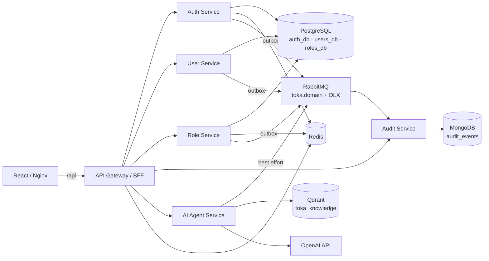
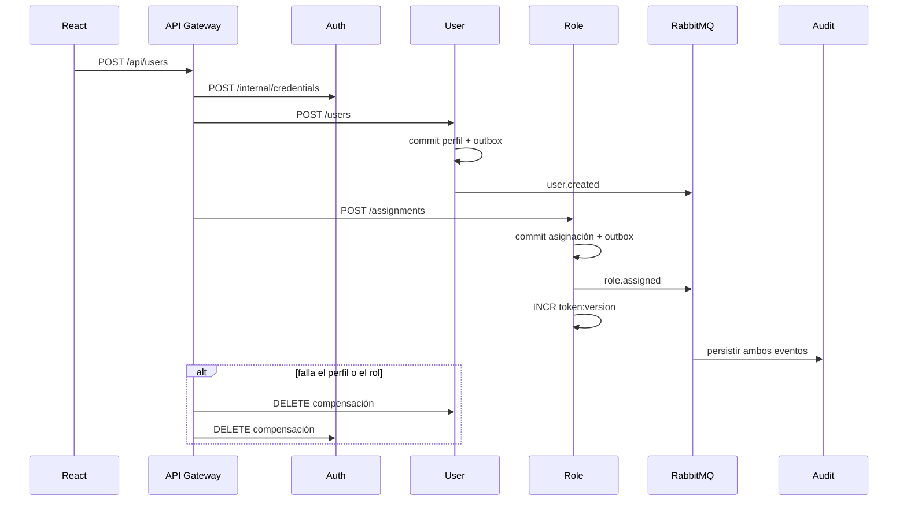

# Arquitectura

Este documento cubre el ejercicio 1.

| Entregable | Dónde |
| --- | --- |
| Diagrama de arquitectura | [Contenedores](#contenedores) |
| Flujo de datos | [Alta de un usuario](#alta-de-un-usuario) |
| Justificación técnica | [Por qué cuatro almacenes](#por-qué-cuatro-almacenes) y [Síncrono, asíncrono y outbox](#síncrono-asíncrono-y-outbox) |
| Diseño de `docker-compose.yml` | [`docker-compose.yml`](../docker-compose.yml), en la raíz. El diagrama de arriba es ese archivo |
| DDD | [Bounded contexts](#bounded-contexts) |
| Clean Architecture | [Clean Architecture](#clean-architecture) |

## Contenedores

## Alta de un usuario

## Bounded contexts

| Contexto | Agregado | Entidades y value objects | Eventos |
| --- | --- | --- | --- |
| Auth | `Credential` | `Email`, hash de contraseña, estado `ACTIVE/DISABLED` | `auth.logged_in`, `auth.logged_out` |
| User | `User` | `Email`, `FullName`, estado | `user.created`, `user.updated`, `user.deactivated` |
| Role | `RoleAssignment` | catálogo `Role` + `Permission` | `role.assigned`, `role.revoked` |
| Audit | `AuditRecord` | sobre del evento, `correlationId`, payload saneado | consume todos |
| AI | consulta RAG | chunk, hit, uso de tokens | `ai.query_completed` |

El usuario no contiene roles. La asignación vive en Role. Auth no guarda el perfil. El identificador de usuario es el mismo UUID en los tres esquemas: no hay foreign keys entre bases.

## Por qué cuatro almacenes

PostgreSQL es el sistema de registro de lo que debe ser consistente: credencial, perfil y RBAC. Cada servicio tiene su base (`auth_db`, `users_db`, `roles_db`) para que un contexto no pueda leer las tablas de otro.

MongoDB recibe el flujo de auditoría. Es append-only, el esquema del payload cambia con el evento y no queremos índices ni locks de esas escrituras dentro de la transacción de usuarios.

Redis no es fuente de verdad. Guarda tres lecturas calientes: la foto `access:user:{id}`, el contador `token:version:{id}` y el hash del refresh. Al asignar un rol se incrementa la versión. El gateway compara esa versión con el claim `tv`. Un JWT viejo muere sin esperar a los 15 minutos. El logout, además, mete el `jti` en una blacklist con el TTL que le queda al access token. Redis persiste con AOF para que un reinicio no borre las revocaciones.

Qdrant guarda vectores de 768 dimensiones con distancia coseno. No tiene sentido meterlos en Postgres ni en Mongo: la búsqueda es por similitud, no por clave.

## Síncrono, asíncrono y outbox

El gateway orquesta en REST lo que el usuario está esperando: login, CRUD y la asignación que debe quedar hecha antes de responder 201. Si el perfil se crea y el rol falla, borra el perfil y la credencial. Es una saga corta con compensación, no un process manager. Si el proceso muere entre los dos pasos puede quedar un huérfano; el outbox no cubre esa ventana y el README lo deja explícito.

Lo que no bloquea la respuesta viaja por RabbitMQ. El exchange `toka.domain` es topic. La cola `audit.events` se ata a `#`. Cada cola de trabajo declara `x-dead-letter-exchange: toka.domain.dlx`. Un mensaje inválido o un fallo del consumidor se `nack` sin requeue y queda en la DLQ para inspección. No hay reintento en caliente: sin delayed-exchange, republicar al momento crearía un loop.

El outbox es la tabla `outbox_events` en la misma transacción que el agregado. Un poller publica y marca `publishedAt`. Si la publicación gana y la marca falla, Audit ignora el `eventId` duplicado. El agente publica `ai.query_completed` en best effort, sin outbox: no tiene Postgres y perder una métrica no puede fallar la respuesta al usuario.

## Clean Architecture

En cada servicio transaccional la dependencia apunta hacia dentro:

- `domain`: entidades y value objects. No conocen TypeORM, HTTP ni JWT.
- `application`: casos de uso y puertos (`UserRepository`, `TokenIssuer`, `AccessDirectory`).
- `infrastructure`: el mapper de TypeORM, Redis, AMQP y los controladores.

TypeORM usa Data Mapper. `UserOrm` no es el agregado. `UserMapper` traduce en el repositorio. `synchronize` está activo solo como interruptor local (`TYPEORM_SYNC`); en un entorno real eso se reemplaza por migraciones.

El gateway valida el JWT y la versión en Redis, inyecta `x-correlation-id` / `x-trace-id` y el permiso del llamador. El servicio de destino vuelve a exigir el token interno y el permiso. Un puerto publicado de un microservicio no queda abierto por el simple hecho de estar en la red de Docker.

Los logs son JSON e incluyen el correlation id. Las contraseñas, tokens y API keys se redactan antes de llegar a Mongo.
